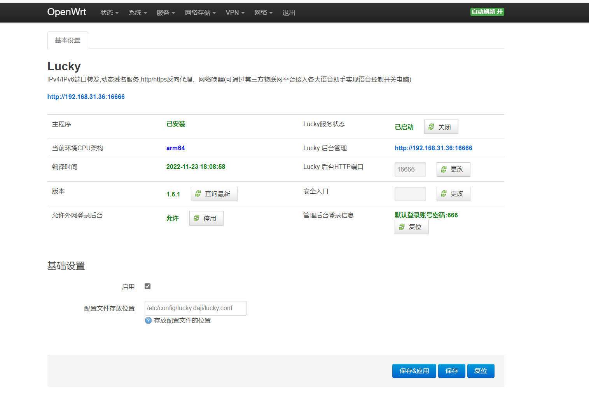
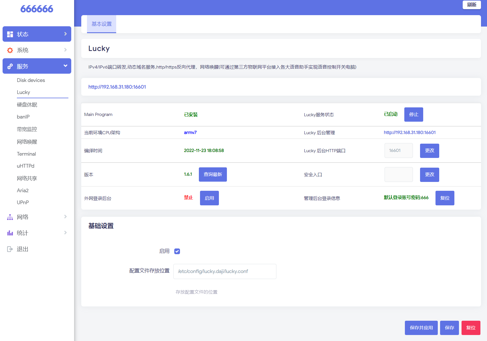

# luci-app-lucky

OpenWrt 的 Lucky 核心包与 LuCI 管理界面，支持服务管理、打开 Lucky 后台及手动刷新状态。

- `lucky`：Lucky 核心。
- `luci-app-lucky`：LuCI 管理界面。
- `luci-i18n-lucky-zh-cn`：简体中文语言包。

## 兼容性

支持 OpenWrt 19.07、21.02、22.03、23.05、24.10（IPK）及 25.12 / Snapshot（APK）。请选择与设备的 OpenWrt 版本和包架构匹配的软件包。

## 安装与升级

将对应的软件包上传到路由器 `/tmp`，在路由器终端执行。

**IPK：**

```sh
opkg install /tmp/lucky_*.ipk
opkg install /tmp/luci-app-lucky_*.ipk /tmp/luci-i18n-lucky-zh-cn_*.ipk
```

**APK：**

```sh
apk add --allow-untrusted /tmp/lucky-*.apk
apk add --allow-untrusted /tmp/luci-app-lucky-*.apk /tmp/luci-i18n-lucky-zh-cn-*.apk
```

安装后进入 LuCI 的 **服务 → Lucky**。

页面分为概览、访问规则和维护。访问规则可编辑配置目录中的 `localips`，以及 Lucky 3.1.0 及以上版本的 `ip-allowlist.txt`；两者均随整目录备份、还原。

LuCI 支持整目录 ZIP 备份与完整替换还原（含隐藏文件和子目录）。操作前停止 Lucky，原本运行时操作结束后恢复运行；此格式仅供 LuCI 还原，不与 Lucky 后台的模块备份混用。

旧版可直接安装新版软件包升级，无需先卸载。升级会保留服务配置和 Lucky 数据，建议提前在 Lucky 后台导出备份。

## 构建与开发

参见 [构建说明](BUILDING.md) 和 [贡献说明](CONTRIBUTING.md)。

## 界面预览

以下为旧版截图，v3 界面随 LuCI 主题自适应。





## License

- Lucky 核心：MIT
- LuCI 管理界面：Apache-2.0

清空配置会先展示删除清单并停止 Lucky，删除配置目录内全部内容后保持停止，手动启动即可生成新配置。仅允许操作空目录或根目录含普通 `.lkcf` 文件的专用配置目录，请先备份。

核心维护支持检测核心缺失、修复执行权限，以及上传匹配架构的 Lucky Linux `tar.gz` 升级包，仅替换核心程序。先检查压缩包与架构，确认后停止服务，再运行新核心校验并替换，降低小内存设备的校验峰值；失败时尝试恢复旧核心与原运行状态。内存不足仍可能导致失败，不能保证 OOM 或断电后的自动恢复。
